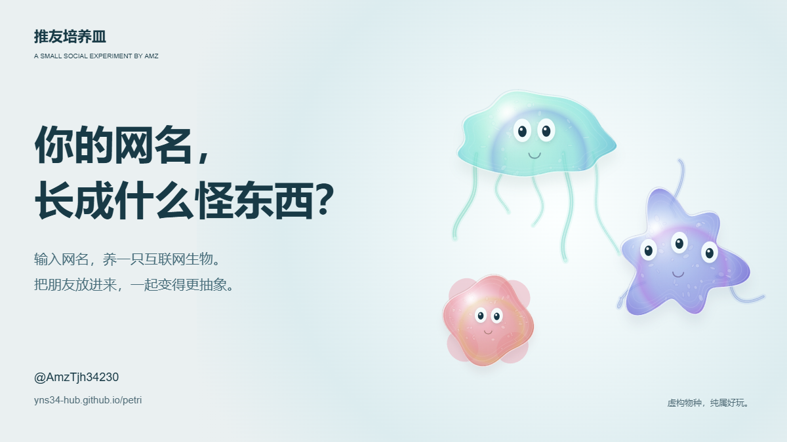

# 推友培养皿

输入网名，生成一只会动的虚构互联网生物。来自 [AMZ / @AmzTjh34230](https://x.com/AmzTjh34230) 的社交小实验。

[打开培养皿](https://yns34-hub.github.io/petri/)



六类生物拥有不同形体、触须、游动和表情。可以投喂、戳一下、暂停动画；加入第二个网名后，培养皿按稳定种子展示六种不同的双人互动。物种与双人结果均为娱乐创作。

## 运行

需要 Node.js 20 或以上版本。无需依赖安装和编译。

```sh
npm start
```

打开 `http://127.0.0.1:4177`。`npm test` 执行 Node 内置测试。

## 文件

- `dist/index.html`、`style.css`：网页与手机布局。
- `dist/genetics.js`：网名校验、稳定生成、双人结果、分享链接。
- `dist/world.js`：原生 Canvas 渲染、生物物理、玻璃培养皿、图片导出。
- `dist/app.js`：表单、投喂、图鉴、分享和下载。
- `dist/press.html`、`press.js`：用同一渲染器生成发布封面、AMZ 物种证件和双人示例。
- `scripts/serve.mjs`：只绑定本机回环地址的静态预览服务器。
- `tests/core.test.mjs`：可复现性、输入边界、形态覆盖、双人对称和链接安全测试。

## 数据与分享

不读取 X 账号，不请求登录，也不调用 AI 或上传输入。网址携带填写的网名和心情，朋友点开能复现同一只生物或同一份双人实验。分享到 X 只打开预填编辑器，由使用者自行决定是否发布。

图片在浏览器本地导出，单人和双人证件均为 1400×1700 PNG；社交封面为 1200×675 PNG。无假排行榜和真人匹配。

动态画面约 30 FPS，像素比限制为 1.5。页面不可见时停止物理和绘制；减少动态效果偏好下默认暂停，可手动继续。

## 更新发布

静态文件从 `gh-pages` 分支根目录发布。

```sh
git push origin main
git subtree push --prefix dist origin gh-pages
```

修改托管域名时，同步修改分享元数据、海报底部网址、素材页网址和本文件链接。
